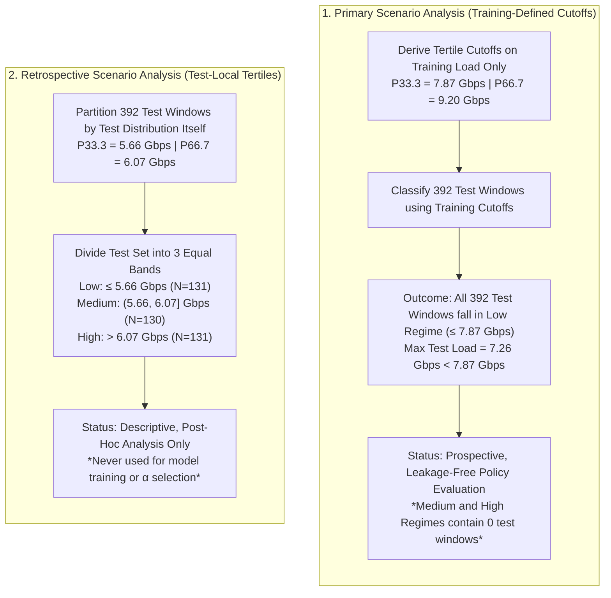

# 5. EXPERIMENTAL SETUP AND PERFORMANCE EVALUATION

*Related project sections: [`introduction.md`](file:///Users/suryavardhan/Documents/Codex/2026-10-23/he/CN%20project/CN_project_download/outputs/introduction.md), [`literature_survey.md`](file:///Users/suryavardhan/Documents/Codex/2026-10-23/he/CN%20project/CN_project_download/outputs/literature_survey.md), [`proposed_system.md`](file:///Users/suryavardhan/Documents/Codex/2026-10-23/he/CN%20project/CN_project_download/outputs/proposed_system.md), [`implementation.md`](file:///Users/suryavardhan/Documents/Codex/2026-10-23/he/CN%20project/CN_project_download/outputs/implementation.md), [`results_discussion_limitations.md`](file:///Users/suryavardhan/Documents/Codex/2026-10-23/he/CN%20project/CN_project_download/outputs/results_discussion_limitations.md), and [`conclusion_future_work.md`](file:///Users/suryavardhan/Documents/Codex/2026-10-23/he/CN%20project/CN_project_download/outputs/conclusion_future_work.md).*  
*Source result files: [`load_aware_model_summary_full.csv`](file:///Users/suryavardhan/Documents/Codex/2026-10-23/he/CN%20project/CN_project_download/outputs/load_aware_model_summary_full.csv), [`load_aware_model_results_full.csv`](file:///Users/suryavardhan/Documents/Codex/2026-10-23/he/CN%20project/CN_project_download/outputs/load_aware_model_results_full.csv), [`load_aware_regimes_summary_full.csv`](file:///Users/suryavardhan/Documents/Codex/2026-10-23/he/CN%20project/CN_project_download/outputs/load_aware_regimes_summary_full.csv), [`load_aware_selected_alphas_full.csv`](file:///Users/suryavardhan/Documents/Codex/2026-10-23/he/CN%20project/CN_project_download/outputs/load_aware_selected_alphas_full.csv), [`load_aware_load_ranges_full.csv`](file:///Users/suryavardhan/Documents/Codex/2026-10-23/he/CN%20project/CN_project_download/outputs/load_aware_load_ranges_full.csv), and [`full_run_log.txt`](file:///Users/suryavardhan/Documents/Codex/2026-10-23/he/CN%20project/CN_project_download/outputs/full_run_log.txt).*

---

## 5.1 Evaluation Metrics

To evaluate forecast quality across the 30 internal directed links, two complementary statistical error metrics are utilized: **Mean Absolute Error (MAE)** and **Root Mean Squared Error (RMSE)**.

### Mathematical Formulations

Let $N = 30$ denote the number of internal links, $B$ denote the number of evaluation windows, $y_{b, i}$ denote the true traffic load on link $i$ at window $b$, and $\hat{y}_{b, i}$ denote the predicted traffic load.

1. **Mean Absolute Error (MAE)**:
   $$\text{MAE} = \frac{1}{B \cdot N} \sum_{b=1}^{B} \sum_{i=1}^{N} \left| y_{b, i} - \hat{y}_{b, i} \right|$$
   MAE measures the average magnitude of absolute errors in physical transmission units. Because deviations are weighted linearly, MAE is robust to isolated outliers and provides an intuitive, unbiased representation of nominal tracking error across operational time steps.

2. **Root Mean Squared Error (RMSE)**:
   $$\text{RMSE} = \sqrt{\frac{1}{B \cdot N} \sum_{b=1}^{B} \sum_{i=1}^{N} \left( y_{b, i} - \hat{y}_{b, i} \right)^2}$$
   RMSE squares each error before averaging, penalizing large errors and unexpected prediction spikes quadratically. In telecommunications and traffic engineering, RMSE is a critical reliability metric: under-predicting an abrupt traffic surge can lead to buffer overflow, packet drops, and Quality-of-Service (QoS) violations.

### Need for Both Metrics

Neither metric alone provides a complete evaluation:
* MAE captures the typical, day-to-day tracking accuracy.
* RMSE exposes vulnerability to extreme errors and traffic bursts.
* The gap between RMSE and MAE reflects the variance of the error distribution: when $\text{RMSE} \gg \text{MAE}$, the model suffers from occasional high-magnitude forecasting failures.

### Physical Unit Conversion (Mbps)

Raw Abilene measurements in `X01.gz` are stored in 5-minute telemetry units where 1 unit corresponds to 8/3 bits per second (bps). To convert error metrics from raw units to Megabits per second (Mbps):
$$\text{Conversion Factor} = \frac{8}{3} \times 10^{-6}\text{ Mbps/unit}$$
All numerical errors throughout this section are reported in Mbps using this verified constant.

---

## 5.2 Scenarios and Experimental Parameters

### Chronological Partitioning and Temporal Parameters

The experimental design evaluates offline time-series forecasting across 2,016 contiguous five-minute snapshots (7 full days) from the Abilene backbone:
* **Input Window**: $H = 12$ consecutive five-minute intervals (60 minutes of history).
* **Forecast Horizon**: 1 step ahead (5 minutes into the future) simultaneously across all $N = 30$ internal directed links.
* **Chronological Split**: A prospective 60% / 20% / 20% split is applied chronologically:
  * **Training Split**: Indices $0$ to $1,208$ ($1,209$ timesteps $\to 1,197$ sliding windows).
  * **Validation Split**: Indices $1,209$ to $1,611$ ($403$ timesteps $\to 391$ sliding windows).
  * **Test Split**: Indices $1,612$ to $2,015$ ($404$ timesteps $\to 392$ sliding windows).
* **Multi-Seed Repeatability**: All models are trained and evaluated across three independent random seeds (7, 21, and 42). Results are presented as the mean $\pm$ sample standard deviation ($\bar{x} \pm s$).

### Distinct Scenario Analyses: Primary vs. Retrospective

To ensure methodological clarity, two scenario analyses are distinguished:

1. **Primary Scenario Analysis (Training-Defined Cutoffs)**:
   * **Definition**: Load regimes are defined strictly from the total observed load (sum across all 30 links at the last input timestep $t=12$) on the training set:
     * **Low Regime**: $\le 7.87\text{ Gbps}$ (P33.3 cutoff: 2,950,478,592 units)
     * **Medium Regime**: $(7.87, 9.20]\text{ Gbps}$ (P33.3 to P66.7)
     * **High Regime**: $> 9.20\text{ Gbps}$ (P66.7 cutoff: 3,450,427,136 units)
   * **Observed Load Shift**: During the test week, observed traffic was systematically lower than during training (Table 5.1). The test set maximum load reached only **7.26 Gbps**, falling 0.61 Gbps below the training Low/Medium cutoff (7.87 Gbps).
   * **Consequence**: **All 392 test windows fall into the training-defined Low regime**. Medium and High test regimes contain zero windows and **could not be evaluated under this prospective definition**.

**Table 5.1. Observed Total Link Load Ranges Across Splits (Gbps, across all 30 links)**

| Split | Windows ($N$) | Min | P10 | P33.3 | P50 | P66.7 | P90 | Max | Mean | Std |
|---|---|---|---|---|---|---|---|---|---|---|
| **Train** | 1,197 | 5.43 | 6.73 | **7.87** | 8.44 | **9.20** | 10.18 | 22.12 | 8.54 | 1.53 |
| **Val** | 391 | 4.74 | 5.31 | 6.25 | 6.89 | 7.52 | 8.87 | 14.35 | 6.98 | 1.35 |
| **Test** | 392 | 4.98 | 5.31 | 5.66 | 5.87 | 6.07 | 6.58 | **7.26** | 5.89 | 0.48 |

2. **Retrospective Scenario Analysis (Test-Local Tertiles)**:
   * **Definition**: To gain descriptive insight into model behavior across load variations *within* the test partition, the 392 test windows were divided into equal tertiles based on the test set's own empirical distribution:
     * **Test-Local Low**: $\le 5.66\text{ Gbps}$ ($N = 131$)
     * **Test-Local Medium**: $(5.66, 6.07]\text{ Gbps}$ ($N = 130$)
     * **Test-Local High**: $> 6.07\text{ Gbps}$ ($N = 131$)
   * **Crucial Limitation**: These boundaries were derived post-hoc from test data. They have **no prospective validity** and were **never used for model training, tuning, or $\alpha$ selection**.

---

## 5.3 Experimental Results

### Validation Selection Outcome

The candidate mixing weight $\alpha \in \{0.00, 0.25, 0.50, 0.75, 1.00\}$ was evaluated independently for each training-defined regime and each random seed using validation-set MAE alone. Table 5.2 reports the selected $\alpha^*$ and the corresponding validation scores recorded in [`outputs/load_aware_selected_alphas_full.csv`](file:///Users/suryavardhan/Documents/Codex/2026-10-23/he/CN%20project/CN_project_download/outputs/load_aware_selected_alphas_full.csv).

**Table 5.2. Validation Selection of Mixing Weight $\alpha^*$ (Validation MAE Criterion)**

| Seed | Load Regime | Training Cutoff | Selected $\alpha^*$ | Validation MAE (Mbps) | Validation RMSE (Mbps) |
|---|---|---|---|---|---|
| **7** | Low | $\le 7.87\text{ Gbps}$ | **0.00** | 21.81 | 31.58 |
| **7** | Medium | $(7.87, 9.20]\text{ Gbps}$ | **0.00** | 23.45 | 40.70 |
| **7** | High | $> 9.20\text{ Gbps}$ | **0.00** | 37.98 | 81.06 |
| **21** | Low | $\le 7.87\text{ Gbps}$ | **0.00** | 21.86 | 31.78 |
| **21** | Medium | $(7.87, 9.20]\text{ Gbps}$ | **0.00** | 23.51 | 40.53 |
| **21** | High | $> 9.20\text{ Gbps}$ | **0.00** | 37.86 | 83.54 |
| **42** | Low | $\le 7.87\text{ Gbps}$ | **0.00** | 21.97 | 31.80 |
| **42** | Medium | $(7.87, 9.20]\text{ Gbps}$ | **0.00** | 23.92 | 41.32 |
| **42** | High | $> 9.20\text{ Gbps}$ | **0.00** | 39.31 | 90.26 |

Across all 9 (seed, regime) combinations, the validation sweep uniformly selected **$\alpha^* = 0.00$**. The resulting model is therefore a **static Similarity-only Graph-GRU ($\alpha = 0$)**. It is **not adaptive**, as the policy never dynamically switches graph weights, and the physical graph component is completely unused.

### Primary Overall Test Performance

Table 5.3 reports test performance across all 392 test windows (all within the Low training-defined regime), averaged over seeds 7, 21, and 42.

**Table 5.3. Overall Test Performance Across All 392 Test Windows (Mean $\pm$ Std, 3 Seeds)**

| Model Architecture | Graph Prior | Test MAE (Mbps) | Test RMSE (Mbps) | Seed 7 MAE | Seed 21 MAE | Seed 42 MAE |
|---|---|---|---|---|---|---|
| **Similarity-only Graph-GRU** | Empirical $A_{\text{sim}}$ ($\alpha = 0.00$) | **$22.28 \pm 0.03$** | **$30.68 \pm 0.06$** | 22.25 | 22.29 | 22.29 |
| **Fixed 50/50 Mixed Graph-GRU** | Hybrid $A(0.50)$ ($\alpha = 0.50$) | $22.91 \pm 0.34$ | $32.72 \pm 0.64$ | 22.86 | 23.27 | 22.60 |
| **Temporal Baseline ([`GRUBaseline`](file:///Users/suryavardhan/Documents/Codex/2026-10-23/he/CN%20project/CN_project_download/src/models.py#L6-L15))** | None (Temporal Only) | $22.80 \pm 1.35$ | $33.25 \pm 2.54$ | 23.55 | 21.24 | 23.62 |
| **Physical Graph-GRU** | Topology $A_{\text{phys}}$ ($\alpha = 1.00$) | $25.47 \pm 0.14$ | $36.66 \pm 0.40$ | 25.37 | 25.64 | 25.40 |

*Note: The $\alpha^*$-selected policy row is numerically identical to the Similarity-only row because $\alpha^* = 0.00$ was selected everywhere.*

### Retrospective Test-Local Scenario Results

Table 5.4 reports performance partitioned by test-local tertiles, recorded in [`outputs/load_aware_regimes_summary_full.csv`](file:///Users/suryavardhan/Documents/Codex/2026-10-23/he/CN%20project/CN_project_download/outputs/load_aware_regimes_summary_full.csv).

**Table 5.4. Retrospective Test-Local Tertile Performance (Mean $\pm$ Std, 3 Seeds)**

| Test-Local Band | Windows ($N$) | Metric | Similarity-only ($\alpha=0.0$) | Fixed 50/50 ($\alpha=0.5$) | Temporal GRU | Physical Graph ($\alpha=1.0$) |
|---|---|---|---|---|---|---|
| **Low [test-local]** ($\le 5.66\text{ Gbps}$) | 131 | MAE (Mbps) RMSE (Mbps) | **$21.39 \pm 0.02$** **$29.72 \pm 0.15$** | $24.60 \pm 0.59$ $36.22 \pm 1.02$ | $26.67 \pm 2.23$ $38.29 \pm 4.22$ | $27.26 \pm 0.29$ $40.10 \pm 0.74$ |
| **Medium [test-local]** ($(5.66, 6.07]\text{ Gbps}$) | 130 | MAE (Mbps) RMSE (Mbps) | **$21.69 \pm 0.03$** **$29.92 \pm 0.05$** | $22.94 \pm 0.37$ $32.64 \pm 0.67$ | $22.16 \pm 1.56$ $32.14 \pm 2.69$ | $26.66 \pm 0.15$ $37.87 \pm 0.36$ |
| **High [test-local]** ($> 6.07\text{ Gbps}$) | 131 | MAE (Mbps) RMSE (Mbps) | $23.75 \pm 0.05$ $32.32 \pm 0.04$ | $21.19 \pm 0.07$ $28.87 \pm 0.15$ | **$19.57 \pm 0.29$** **$28.51 \pm 0.36$** | $22.50 \pm 0.03$ $31.46 \pm 0.05$ |

---

## 5.4 Analysis and Discussion

### Relative Percentage Error Reductions

Percentage error reductions are computed strictly using the standard formulation:
$$\text{Percentage Error Reduction} = \frac{\text{Baseline Error} - \text{Selected Model Error}}{\text{Baseline Error}} \times 100$$
where the selected model is the Similarity-only Graph-GRU ($\alpha = 0.00$). Positive values denote error reductions (improvements), while negative values denote error increases (degradations / worse performance).

Table 5.5 details the exact percentage changes relative to each baseline across overall and test-local scenarios.

**Table 5.5. Percentage Error Reductions of Similarity-Only Model ($\alpha=0.00$) Relative to Baselines**

| Scenario Band | Comparison Baseline | Baseline MAE | Selected MAE | $\Delta$ MAE (%) | Baseline RMSE | Selected RMSE | $\Delta$ RMSE (%) |
|---|---|---|---|---|---|---|---|
| **Overall Test** | vs. Physical Graph ($\alpha=1.0$) | 25.47 Mbps | 22.28 Mbps | **+12.53%** (Better) | 36.66 Mbps | 30.68 Mbps | **+16.31%** (Better) |
| **Overall Test** | vs. Fixed 50/50 Mix ($\alpha=0.5$) | 22.91 Mbps | 22.28 Mbps | **+2.76%** (Better) | 32.72 Mbps | 30.68 Mbps | **+6.22%** (Better) |
| **Overall Test** | vs. Temporal GRU Baseline | 22.80 Mbps | 22.28 Mbps | **+2.31%** (Better) | 33.25 Mbps | 30.68 Mbps | **+7.72%** (Better) |
| **Low [test-local]** | vs. Physical Graph ($\alpha=1.0$) | 27.26 Mbps | 21.39 Mbps | **+21.54%** (Better) | 40.10 Mbps | 29.72 Mbps | **+25.89%** (Better) |
| **Low [test-local]** | vs. Fixed 50/50 Mix ($\alpha=0.5$) | 24.60 Mbps | 21.39 Mbps | **+13.05%** (Better) | 36.22 Mbps | 29.72 Mbps | **+17.96%** (Better) |
| **Low [test-local]** | vs. Temporal GRU Baseline | 26.67 Mbps | 21.39 Mbps | **+19.81%** (Better) | 38.29 Mbps | 29.72 Mbps | **+22.38%** (Better) |
| **Medium [test-local]** | vs. Physical Graph ($\alpha=1.0$) | 26.66 Mbps | 21.69 Mbps | **+18.62%** (Better) | 37.87 Mbps | 29.92 Mbps | **+20.97%** (Better) |
| **Medium [test-local]** | vs. Fixed 50/50 Mix ($\alpha=0.5$) | 22.94 Mbps | 21.69 Mbps | **+5.43%** (Better) | 32.64 Mbps | 29.92 Mbps | **+8.31%** (Better) |
| **Medium [test-local]** | vs. Temporal GRU Baseline | 22.16 Mbps | 21.69 Mbps | **+2.12%** (Better) | 32.14 Mbps | 29.92 Mbps | **+6.90%** (Better) |
| **High [test-local]** | vs. Physical Graph ($\alpha=1.0$) | 22.50 Mbps | 23.75 Mbps | **-5.54% (Worse)** | 31.46 Mbps | 32.32 Mbps | **-2.74% (Worse)** |
| **High [test-local]** | vs. Fixed 50/50 Mix ($\alpha=0.5$) | 21.19 Mbps | 23.75 Mbps | **-12.06% (Worse)** | 28.87 Mbps | 32.32 Mbps | **-11.95% (Worse)** |
| **High [test-local]** | vs. Temporal GRU Baseline | 19.57 Mbps | 23.75 Mbps | **-21.36% (Worse)** | 28.51 Mbps | 32.32 Mbps | **-13.37% (Worse)** |

### Performance Trade-Offs Across Load Bands

The empirical analysis reveals a nuanced performance pattern that challenges simplistic assumptions of uniform superiority:

1. **Overall Superiority of Similarity-Only Prior**:
   On aggregate, the Similarity-only Graph-GRU achieves the lowest test MAE (22.28 Mbps) and RMSE (30.68 Mbps), outperforming the Physical Graph-GRU by 12.53% in MAE and 16.31% in RMSE. This indicates that correlation-derived similarity is a more effective structural prior than physical router connectivity for the Abilene topology.
2. **Pronounced Advantage During Low-Traffic Periods**:
   In the test-local Low band ($\le 5.66$ Gbps), the Similarity-only model achieves its largest margin of victory, reducing MAE by **19.81%** over the GRU baseline and **21.54%** over the Physical Graph. During low-load periods, individual link telemetry is noisy; propagating signals across correlated links provides a strong stabilizing regularizer.
3. **Inversion During High-Traffic Periods**:
   In the test-local High band ($> 6.07$ Gbps), the ranking reverses: the **GRU temporal baseline performs best** (19.57 Mbps MAE), followed by the Fixed 50/50 mix (21.19 Mbps) and the Physical Graph (22.50 Mbps). The Similarity-only model ranks last (23.75 Mbps MAE, **21.36% worse** than the GRU baseline). During high-load surges, heavy traffic flows dominate link dynamics along specific routing paths; static historical correlation graphs may diffuse irrelevant signals from links that are not actively congested, whereas a pure temporal model tracks the localized surge directly without graph dilution.
4. **Optimization and Seed Stability**:
   The GRU temporal baseline exhibits substantial sensitivity to random seed initialization, with standard deviations of $1.35\text{ Mbps}$ overall and $2.23\text{ Mbps}$ in the Low band. In contrast, the Similarity-only Graph-GRU exhibits exceptional optimization stability across seeds ($s = 0.03\text{ Mbps}$ overall), demonstrating that graph message passing smooths the loss landscape and produces consistent convergence.
5. **Absence of Formal Statistical Significance**:
   While the mean differences between models are clearly quantified, **no claim of formal statistical significance is made**. With three random seeds ($N = 3$), the sample size is insufficient to conduct robust paired t-tests or Wilcoxon signed-rank tests with high statistical power. The reported findings represent empirical observations within this specific experimental run.

---

## 5.5 Critical Evaluation and Limitations

A rigorous evaluation requires acknowledging both the strengths and concrete limitations of the project:

### System Strengths
1. **Zero Data Leakage**: Preprocessing scaling, Pearson correlation graph construction, and $\alpha$ parameter selection were strictly isolated to training and validation splits. Test data was never accessed during model training or selection.
2. **Empirical Grounding**: Findings directly reflect measured code execution. The non-adaptive outcome ($\alpha^* = 0.00$) was reported factually, rather than altering criteria to force an adaptive claim.
3. **Exceptional Model Stability**: Graph message passing over empirical correlation links yielded standard deviations of $\pm 0.03\text{ Mbps}$ across random seeds, drastically reducing the initialization sensitivity observed in standard GRUs ($\pm 1.35\text{ Mbps}$).

### System Weaknesses and Constraints

1. **One-Week Dataset Duration**:
   The Abilene trace spans only one calendar week (2,016 five-minute samples). While standard for preliminary benchmark comparisons, a single week cannot capture monthly seasonality, multi-week trend shifts, or major structural network reconfigurations.
2. **Train-to-Test Dataset Load Shift**:
   The primary evaluation was constrained to the Low regime because the maximum observed test load (7.26 Gbps) remained strictly below the training Low/Medium threshold (7.87 Gbps). **Medium and High test regimes could not be evaluated under the prospective policy**. Whether similarity-based graph models maintain superiority under sustained high-load test conditions remains unproven by this dataset.
3. **Non-Adaptive Outcome**:
   The regime-conditioned framework was designed to select different $\alpha$ values across traffic bands, but validation MAE monotonically worsened as $\alpha$ increased. The framework uniformly selected $\alpha^* = 0.00$, collapsing the system into a static model.
4. **Retrospective Nature of Scenario Breakdown**:
   The test-local tertile breakdown (Table 5.4) provided essential insight into high-load degradation, but it is strictly a retrospective, post-hoc analysis. Because test-local boundaries were derived from test telemetry, they cannot be deployed in an operational system.
5. **Physical Graph Degradation**:
   The Physical Graph-GRU ($\alpha = 1.00$) performed worst across both metrics (25.47 Mbps MAE, 36.66 Mbps RMSE). Enforcing physical router adjacency forced message passing between links that share a core router but carry unrelated transit traffic, injecting structural noise into the recurrent hidden states.

