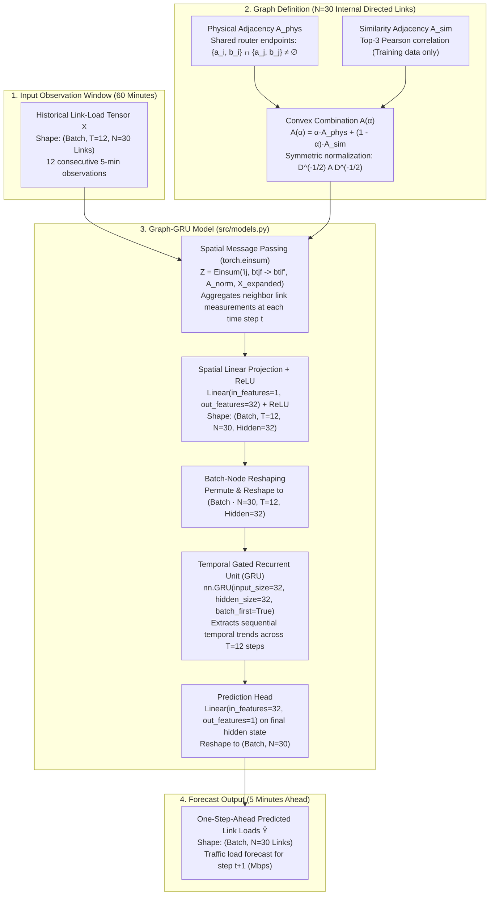
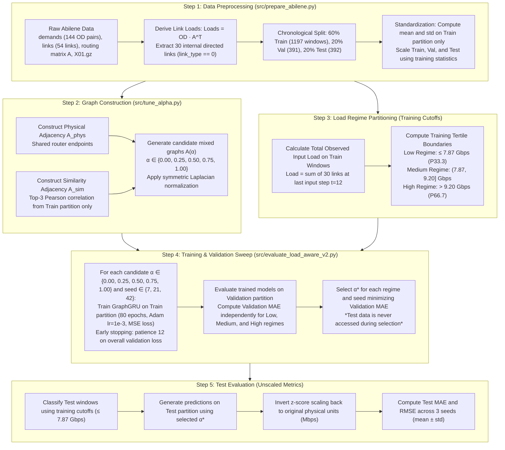

# 3. PROPOSED SYSTEM

*Related project sections: [`introduction.md`](file:///Users/suryavardhan/Documents/Codex/2026-10-23/he/CN%20project/CN_project_download/outputs/introduction.md), [`literature_survey.md`](file:///Users/suryavardhan/Documents/Codex/2026-10-23/he/CN%20project/CN_project_download/outputs/literature_survey.md), [`results_discussion_limitations.md`](file:///Users/suryavardhan/Documents/Codex/2026-10-23/he/CN%20project/CN_project_download/outputs/results_discussion_limitations.md), and [`conclusion_future_work.md`](file:///Users/suryavardhan/Documents/Codex/2026-10-23/he/CN%20project/CN_project_download/outputs/conclusion_future_work.md).*  
*Source code: [`src/models.py`](file:///Users/suryavardhan/Documents/Codex/2026-10-23/he/CN%20project/CN_project_download/src/models.py), [`src/prepare_abilene.py`](file:///Users/suryavardhan/Documents/Codex/2026-10-23/he/CN%20project/CN_project_download/src/prepare_abilene.py), [`src/train.py`](file:///Users/suryavardhan/Documents/Codex/2026-10-23/he/CN%20project/CN_project_download/src/train.py), [`src/tune_alpha.py`](file:///Users/suryavardhan/Documents/Codex/2026-10-23/he/CN%20project/CN_project_download/src/tune_alpha.py), and [`src/evaluate_load_aware_v2.py`](file:///Users/suryavardhan/Documents/Codex/2026-10-23/he/CN%20project/CN_project_download/src/evaluate_load_aware_v2.py).*

---

## 3.1 System Architecture and Topology

The forecasting system implemented in this project predicts future traffic loads across the internal transmission links of the Abilene Internet backbone network. The target architecture maps link-level measurements to graph vertices and couples spatial aggregation with recurrent temporal tracking.



### Graph Formulation: Links as Vertices

In contrast to router-centric graphs where vertices represent network nodes, our graph treats the **30 internal directed links** of the Abilene network as graph vertices ($N = 30$):
* **Internal Directed Links**: The Abilene network consists of 12 core routers connected by 15 full-duplex physical lines, corresponding to 30 directed internal links (identified from `data/raw/abilene/links` by filtering for link type 0 in [`src/prepare_abilene.py`](file:///Users/suryavardhan/Documents/Codex/2026-10-23/he/CN%20project/CN_project_download/src/prepare_abilene.py#L43-L49)). External access and peering interfaces are excluded.
* **Input Horizon and Prediction Step**:
  * Input observation window: $T = 12$ consecutive steps (12 samples $\times$ 5 minutes = 60 minutes of history).
  * Forecast horizon: 1 step ahead (5 minutes into the future) simultaneously across all 30 internal links.
  * Input tensor: $X \in \mathbb{R}^{B \times 12 \times 30}$ (where $B$ is batch size).
  * Output tensor: $\hat{Y} \in \mathbb{R}^{B \times 30}$.

### Adjacency Matrices: Physical vs. Similarity Graphs

Two distinct graph topologies are constructed over the 30 link vertices:

1. **Physical Adjacency Matrix ($A_{\text{phys}} \in \mathbb{R}^{30 \times 30}$)**:
   * Two directed links $i$ and $j$ are connected by an undirected edge if they share at least one router endpoint:
     $$\{a_i, b_i\} \cap \{a_j, b_j\} \neq \emptyset$$
     where $a_k$ and $b_k$ denote the source and destination routers of directed link $k$.
   * Self-loops are included ($A_{\text{phys}, ii} = 1$).
   * Symmetric normalization is applied:
     $$\tilde{A}_{\text{phys}} = D_{\text{phys}}^{-1/2} A_{\text{phys}} D_{\text{phys}}^{-1/2}, \quad D_{\text{phys}, ii} = \max\left(\sum_{j} A_{\text{phys}, ij}, 10^{-8}\right)$$

2. **Similarity Adjacency Matrix ($A_{\text{sim}} \in \mathbb{R}^{30 \times 30}$)**:
   * Computed **strictly from the training partition** (the first 60% of the dataset) to prevent any data leakage into validation or testing periods.
   * Pairwise Pearson correlation coefficients are computed across the training time series:
     $$C_{ij} = \frac{\sum_{t=1}^{T_{\text{train}}} (x_{t,i} - \bar{x}_i)(x_{t,j} - \bar{x}_j)}{\sqrt{\sum_{t=1}^{T_{\text{train}}} (x_{t,i} - \bar{x}_i)^2} \sqrt{\sum_{t=1}^{T_{\text{train}}} (x_{t,j} - \bar{x}_j)^2}}$$
   * For each link $i$, its top-3 strongest positive correlations ($C_{ij} > 0, j \neq i$) are identified.
   * Undirected edge weights are assigned symmetrically: $A_{\text{sim}, ij} = A_{\text{sim}, ji} = \max(A_{\text{sim}, ij}, C_{ij})$.
   * Self-loops are added ($A_{\text{sim}, ii} = 1$), followed by symmetric normalization:
     $$\tilde{A}_{\text{sim}} = D_{\text{sim}}^{-1/2} A_{\text{sim}} D_{\text{sim}}^{-1/2}$$

---

## 3.2 Baseline Mechanisms

Four distinct model mechanisms are implemented and evaluated within the experimental framework:

### 1. Temporal Baseline: [`GRUBaseline`](file:///Users/suryavardhan/Documents/Codex/2026-10-23/he/CN%20project/CN_project_download/src/models.py#L6-L15)
* **Architecture**: A pure sequence model without spatial message passing.
* **Mechanism**: Takes the unexpanded tensor $X \in \mathbb{R}^{B \times 12 \times 30}$ directly into a 64-unit Gated Recurrent Unit (`nn.GRU(input_size=30, hidden_size=64, batch_first=True)`).
* **Head**: The final hidden state $h_{12} \in \mathbb{R}^{B \times 64}$ passes through a linear projection (`nn.Linear(64, 30)`) to yield the 30 link forecasts.
* **Purpose**: Serves as a purely temporal deep learning benchmark (analogous to the LSTM mechanism in NeuTM [4]), capturing temporal autocorrelation without topological inductive bias.

### 2. Physical Graph-GRU: [`GraphGRU`](file:///Users/suryavardhan/Documents/Codex/2026-10-23/he/CN%20project/CN_project_download/src/models.py#L17-L32) ($\alpha = 1.00$)
* **Mechanism**: Uses the normalized physical adjacency matrix $\tilde{A}_{\text{phys}}$.
* **Spatial Step**: At each time step $t \in \{1, \dots, 12\}$, spatial aggregation is performed via Einstein summation:
  $$Z_{b, t, i} = \sum_{j=1}^{30} \tilde{A}_{ij} X_{b, t, j}$$
  followed by a linear mapping (`nn.Linear(1, 32)`) and ReLU non-linearity, producing feature vectors of dimension 32 for each link at each time step.
* **Temporal Step**: The spatial tensor is reshaped to $(B \cdot 30, 12, 32)$ and processed by a 32-unit GRU cell (`nn.GRU(input_size=32, hidden_size=32, batch_first=True)`). The final hidden state is projected through `nn.Linear(32, 1)` and reshaped to $(B, 30)$.
* **Relationship to DCRNN**: This implementation performs normalized adjacency aggregation followed by a recurrent GRU. It is a **course-scale experimental comparison**, **not an exact DCRNN implementation**. Andreoletti et al. [1] is the conceptual reference paper; their architecture integrates bidirectional random-walk matrix polynomial diffusions directly inside the recurrent gating equations, whereas our Graph-GRU performs spatial message passing followed by temporal sequence modeling.

### 3. Similarity-Graph Graph-GRU: [`GraphGRU`](file:///Users/suryavardhan/Documents/Codex/2026-10-23/he/CN%20project/CN_project_download/src/models.py#L17-L32) ($\alpha = 0.00$)
* **Mechanism**: Shares the identical architecture and parameter count as the Physical Graph-GRU, but substitutes $\tilde{A}_{\text{phys}}$ with the normalized empirical similarity matrix $\tilde{A}_{\text{sim}}$.
* **Purpose**: Evaluates whether propagating information along links with high historical traffic co-movement provides a superior structural inductive bias compared to physical endpoint proximity.

### 4. Fixed Mixed Graph-GRU: [`GraphGRU`](file:///Users/suryavardhan/Documents/Codex/2026-10-23/he/CN%20project/CN_project_download/src/models.py#L17-L32) ($\alpha = 0.50$)
* **Mechanism**: Uses a fixed 50/50 convex combination of unnormalized physical and similarity graphs:
  $$A(0.50) = 0.50 \cdot A_{\text{phys}} + 0.50 \cdot A_{\text{sim}}$$
  followed by symmetric normalization.
* **Purpose**: Tests the hypothesis that combining physical topological connectivity with behavioral correlation improves forecast stability.

---

## 3.3 Proposed Mechanism: Adjacency Mixing and Validation Selection

### Convex Combination Formulation

The proposed framework explores whether network structure can be optimized by interpolating between physical adjacency and empirical similarity through a scalar mixing parameter $\alpha \in [0, 1]$:

$$A(\alpha) = \alpha A_{\text{phys}} + (1 - \alpha) A_{\text{sim}}$$

* When $\alpha = 1.00$, $A(\alpha)$ reduces strictly to the physical topology graph.
* When $\alpha = 0.00$, $A(\alpha)$ reduces strictly to the training-data similarity graph.
* When $0 < \alpha < 1$, $A(\alpha)$ represents a mixed graph balancing physical endpoint proximity with traffic co-movement.
* Following mixing, symmetric normalization is applied:
  $$\tilde{A}(\alpha) = D(\alpha)^{-1/2} A(\alpha) D(\alpha)^{-1/2}, \quad D(\alpha)_{ii} = \max\left(\sum_{j} A(\alpha)_{ij}, 10^{-8}\right)$$

### End-to-End Pipeline

The end-to-end execution pipeline—encompassing preprocessing, graph building, training, validation selection, and testing—is illustrated in Figure 3.2.



### Pipeline Pseudocode

```python
# -------------------------------------------------------------------------
# Pseudocode: End-to-End Load-Aware Graph-GRU Forecasting Pipeline
# -------------------------------------------------------------------------

# Step 1: Preprocessing & Leakage-Free Normalization
raw_loads = extract_internal_30_links("data/raw/abilene/")
train_raw, val_raw, test_raw = chronological_split(raw_loads, ratios=[0.60, 0.20, 0.20])
mean, std = train_raw.mean(axis=0), train_raw.std(axis=0)
train_x, train_y = create_sliding_windows((train_raw - mean) / std, history=12)
val_x,   val_y   = create_sliding_windows((val_raw   - mean) / std, history=12)
test_x,  test_y  = create_sliding_windows((test_raw  - mean) / std, history=12)

# Step 2: Graph Construction (Training Data Only)
A_phys = build_physical_endpoint_graph(internal_link_metadata)
A_sim  = build_top3_pearson_graph(train_raw)

# Step 3: Training-Defined Load Regime Thresholds
train_observed_load = unscale(train_x[:, -1, :], mean, std).sum(axis=-1)
cutoff_low_med = percentile(train_observed_load, 33.33)   # 7.87 Gbps
cutoff_med_high = percentile(train_observed_load, 66.67)  # 9.20 Gbps

# Step 4: Training & Alpha Selection on Validation MAE
alpha_candidates = [0.00, 0.25, 0.50, 0.75, 1.00]
selected_alpha = {}

for seed in [7, 21, 42]:
    set_seed(seed)
    trained_models = {}
    for alpha in alpha_candidates:
        A_norm = normalize(alpha * A_phys + (1 - alpha) * A_sim)
        model = GraphGRU(n_links=30, hidden=32)
        model.fit(train_x, train_y, val_x, val_y, A_norm, epochs=80, patience=12)
        trained_models[alpha] = model
    
    # Classify validation windows into regimes
    val_observed_load = unscale(val_x[:, -1, :], mean, std).sum(axis=-1)
    for regime in ["Low", "Medium", "High"]:
        mask = get_regime_mask(val_observed_load, regime, cutoff_low_med, cutoff_med_high)
        # Select alpha minimizing validation MAE only
        best_alpha = argmin([mae(trained_models[a].predict(val_x[mask], A_norm[a]), val_y[mask]) 
                             for a in alpha_candidates])
        selected_alpha[seed, regime] = best_alpha

# Step 5: Test Evaluation
# All test windows classified via training cutoffs; evaluated using selected_alpha
test_observed_load = unscale(test_x[:, -1, :], mean, std).sum(axis=-1)
test_preds = predict(trained_models[selected_alpha], test_x)
test_mae  = mean_absolute_error(unscale(test_preds), unscale(test_y))
test_rmse = root_mean_squared_error(unscale(test_preds), unscale(test_y))
```

---

## 3.4 Novelty Statement

The scientific contribution of this project is characterized strictly and narrowly as an **empirical graph-design and evaluation choice** for link-load forecasting on the Abilene backbone network. It explores whether substituting or blending physical link adjacency with data-driven traffic similarity provides measurable utility under controlled, leakage-free conditions.

### Factual Findings and Model Classification

1. **Non-Adaptive Selection Outcome**:
   In the validation grid sweep across $\alpha \in \{0.00, 0.25, 0.50, 0.75, 1.00\}$, validation MAE increased monotonically as $\alpha$ increased across all three load regimes and all three random seeds (as recorded in [`outputs/load_aware_validation_regime_scores_full.csv`](file:///Users/suryavardhan/Documents/Codex/2026-10-23/he/CN%20project/CN_project_download/outputs/load_aware_validation_regime_scores_full.csv)). Consequently, the validation-based policy uniformly selected:
   $$\alpha^* = 0.00 \quad \text{for every regime and seed}$$
   The resulting model is therefore a **static Similarity-only Graph-GRU ($\alpha = 0$)**. It is **not adaptive**, as the policy never dynamically switches graph weights, and the physical graph component is entirely unused.
2. **No Claim of Mixed Model Superiority**:
   The mixed model ($\alpha = 0.50$) did **not** perform best. On test data, the Similarity-only model achieved lower MAE ($22.28 \pm 0.03\text{ Mbps}$) and RMSE ($30.68 \pm 0.06\text{ Mbps}$) than the 50/50 mixed model ($22.91 \pm 0.34\text{ Mbps}$ MAE; $32.72 \pm 0.64\text{ Mbps}$ RMSE).
3. **No Claim of Globally Novel Method**:
   This project does not introduce a globally proven novel neural network architecture. Rather, its value lies in demonstrating through reproducible experimentation that physical router topology is an inferior inductive prior compared to empirical correlation graphs for Abilene link loads, challenging an unverified assumption widespread in prior GNN networking literature.

---

## 3.5 Assumptions and Design Decisions

The design choices, structural assumptions, and experimental boundaries governing the implementation are detailed in Table 3.1.

**Table 3.1. System Assumptions and Design Decisions**

| Design Parameter | Setting | Technical Justification and Impact |
|---|---|---|
| **Dataset & Timespan** | One-week Abilene network trace (`X01.gz`) | Sourced from public Texas/Abilene traffic matrix repositories; provides 1,209 contiguous five-minute snapshots across 12 router points-of-presence. Evaluated as a controlled benchmark rather than broad multi-month evidence. |
| **Node Representation** | 30 internal directed links ($N = 30$) | Derived from 54 total links by filtering `link_type == 0`. Access and peering links are omitted because internal backbone routing matrices dictate internal link conservation. |
| **Temporal Sampling** | 5-minute sampling interval | Standard sampling granularity of SNMP/NetFlow telemetry in backbone operations; balances noise smoothing against traffic burst resolution. |
| **Input Horizon** | $T = 12$ steps (60 minutes) | Provides one full hour of recent historical traffic dynamics to capture short-term velocity, trend persistence, and diurnal oscillations. |
| **Forecast Horizon** | 1 step ahead (5 minutes) | Aligns with standard operational traffic engineering intervals, predicting instantaneous load for the next five-minute scheduling epoch. |
| **Data Partitioning** | Chronological 60% Train, 20% Val, 20% Test | Preserves temporal causality: Train = 1,197 windows, Val = 391 windows, Test = 392 windows. Random k-fold cross-validation is avoided to prevent temporal look-ahead leakage. |
| **Leakage Isolation** | Train-only scaling and graph construction | Mean, standard deviation, and Pearson correlation coefficients are computed strictly on the 60% training partition; validation and test splits are strictly out-of-sample. |
| **Repeatability** | Three random seeds (7, 21, 42) | Initializes PyTorch, NumPy, and Python random generators across three independent seeds to quantify initialization sensitivity and report mean $\pm$ sample standard deviation. |
| **Dataset Load Shift** | Test maximum load = 7.26 Gbps <br>(Training Low cutoff = 7.87 Gbps) | **Critical Limitation**: Total observed traffic during the test week was systematically lower than during training. Under the prospective training-defined tertile cutoffs, **100% of test windows fall in the Low regime**. Medium and High test regimes contain zero windows and could not be evaluated. |
| **Early Stopping** | Patience of 12 epochs on validation loss | Prevents overfitting while enabling models with different structural priors to reach empirical convergence on identical budgets (maximum 80 epochs, Adam optimizer, learning rate $10^{-3}$). |

